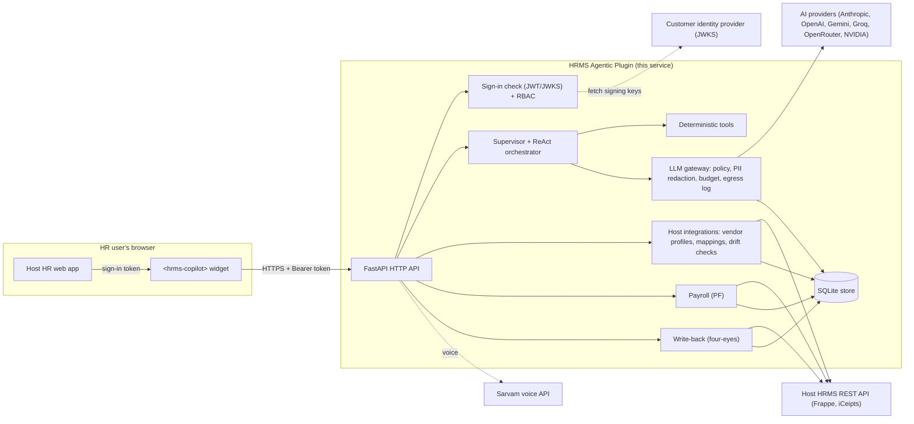
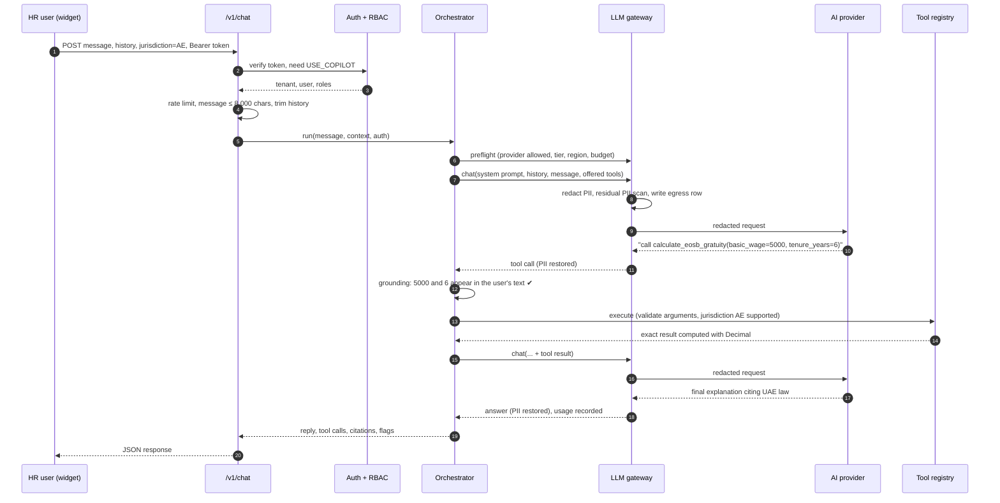
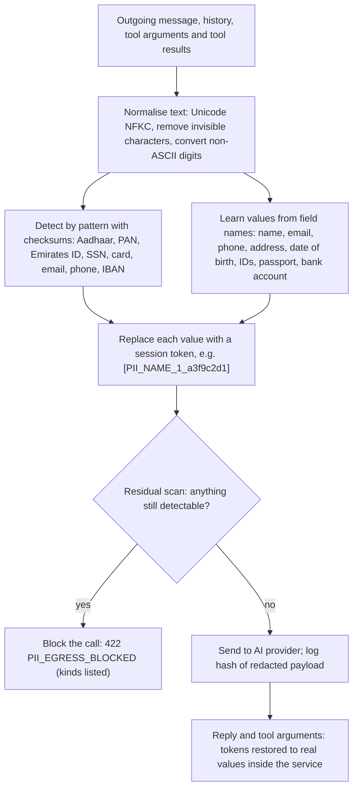
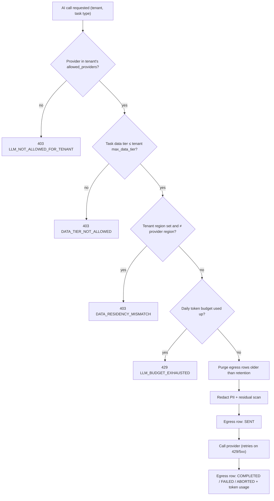
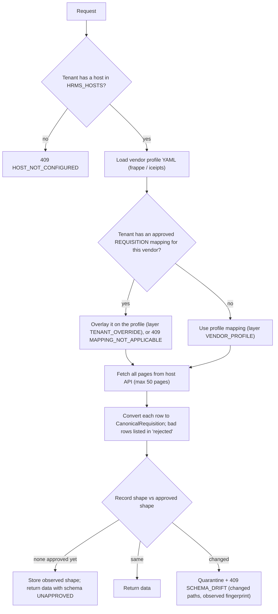
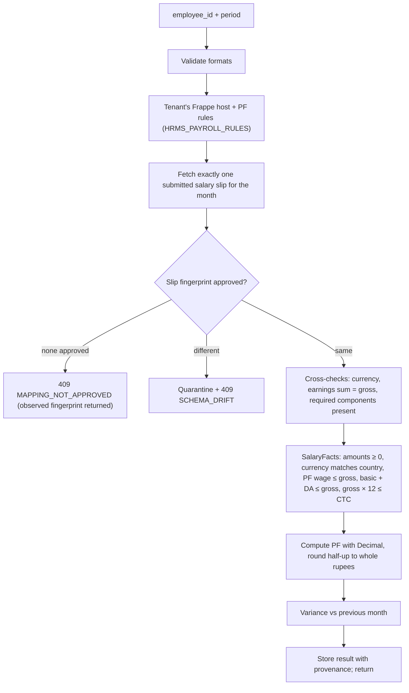
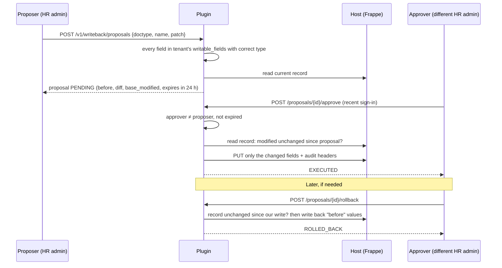

# HRMS Agentic Plugin (`hrms-agentic-plugin`)

An AI copilot service that plugs into an existing HR system (HRMS). It answers HR questions, runs statutory
calculations, reads records from the host HR system, and proposes changes that a second person must approve. It never
connects to the host's database. It talks to the host only through the host's own REST API.

This document is written for everyone involved: business owners, HR and payroll leads, security and compliance
reviewers, architects, developers and operators. Each section says who it is mainly for. Every statement here was
checked against the code on the `agentic-ai` branch; where something is planned but not built, it says so.

---

## Contents

1. [In one page (everyone)](#1-in-one-page)
2. [Glossary (everyone)](#2-glossary)
3. [What is built and what is not (everyone)](#3-what-is-built-and-what-is-not)
4. [Architecture (architects, developers)](#4-architecture)
5. [Flow: a chat question, end to end](#5-flow-a-chat-question-end-to-end)
6. [Flow: how personal data is protected (security, compliance)](#6-flow-how-personal-data-is-protected)
7. [Flow: LLM gateway, policy, cost and logging (security, finance)](#7-flow-llm-gateway-policy-cost-and-logging)
8. [Flow: sign-in, roles and permissions (security)](#8-flow-sign-in-roles-and-permissions)
9. [Flow: reading requisitions from the host HRMS](#9-flow-reading-requisitions-from-the-host-hrms)
10. [Flow: PF payroll calculation (payroll)](#10-flow-pf-payroll-calculation)
11. [Flow: changing host records safely (write-back)](#11-flow-changing-host-records-safely-write-back)
12. [Flow: schema adaptation for a new HR system](#12-flow-schema-adaptation-for-a-new-hr-system)
13. [Flow: voice](#13-flow-voice)
14. [The copilot widget (front-end teams)](#14-the-copilot-widget)
15. [Agent tools reference (HR, developers)](#15-agent-tools-reference)
16. [HTTP API reference](#16-http-api-reference)
17. [Configuration reference (operators)](#17-configuration-reference)
18. [Running and deploying (operators)](#18-running-and-deploying)
19. [Testing and quality evidence](#19-testing-and-quality-evidence)
20. [Known gaps and open decisions](#20-known-gaps-and-open-decisions)
21. [Further documentation](#21-further-documentation)

---

## 1. In one page

**Problem.** HR teams use many HR systems (Frappe HR, iCeipts, Zoho, BambooHR, ...). Each stores the same ideas
(employee, salary, leave, requisition) under different field names. Adding AI to each one separately is slow, and
sending HR data to an AI provider raises privacy and legal risk.

**What this service does.**

- Gives HR users a chat copilot that can embed in any HR web app as one `<hrms-copilot>` element.
- Answers with **numbers computed in code**, never invented by the AI model. If the model tries to use an amount the
  user never gave, the call is refused.
- Reads host records through **configuration files** (one YAML profile per vendor) rather than custom code.
- Changes host records only through **proposals approved by a second person**, with rollback.
- Protects personal data: names, IDs, phone numbers, emails and similar values are replaced with tokens before any
  text leaves for an AI provider, and every call to a provider is logged.
- Lets each customer (tenant) decide which AI providers may see its data, how sensitive that data may be, in which
  region it is processed, how many tokens it may use per day and how many requests per minute.

**What it does not do (yet).** It does not compute payroll for every country (India and UAE only), does not replace
the HR system, and is not yet proven against hosts other than Frappe HR. See [section 20](#20-known-gaps-and-open-decisions).

**Proven so far.**

| Area | Evidence |
|---|---|
| Frappe HR v15 (live sandbox) | PF calculation with exact values, 105 requisitions read across pages, approve and rollback of a record change |
| iCeipts | Vendor profile tested against recorded fixtures (no live iCeipts system available) |
| Automated tests | 2068 passing, 0 failing, 19 skipped (the live Frappe tests, which need the sandbox); 98.9% line coverage |

---

## 2. Glossary

| Term | Meaning |
|---|---|
| **Host / host HRMS** | The customer's existing HR system the plugin connects to (for example Frappe HR). |
| **Tenant** | One customer organisation. Every request belongs to exactly one tenant, taken from its sign-in token. |
| **LLM** | Large language model, the AI model (Anthropic Claude, OpenAI, Gemini, ...) that reads the question and decides which tool to use. |
| **Tool** | A deterministic function the LLM may ask to run, for example "calculate EOSB gratuity". The tool computes; the LLM only explains. |
| **Agent / ReAct loop** | The cycle "model thinks → asks for a tool → service runs it → model reads the result", repeated until there is an answer. |
| **Jurisdiction** | Country whose law applies: IN (India), AE (UAE), SA (Saudi Arabia), US. Statutory calculations support IN and AE only. |
| **Canonical model** | The plugin's own neutral shape of a record (for example `CanonicalRequisition`), independent of any vendor's field names. |
| **Mapping / FieldMap** | Rules that convert a vendor's fields into the canonical model. |
| **Vendor profile** | A YAML file that tells the plugin how to read one vendor's API: URL path, paging, field mapping. |
| **Fingerprint / shape** | A hash of a record's structure (field names and types, not values). If it changes, the plugin stops and asks for approval: this is "schema drift". |
| **PII** | Personally identifiable information: names, emails, phone numbers, national IDs, bank accounts, and so on. |
| **Redaction / token** | Replacing a PII value with a placeholder such as `[PII_NAME_1_a3f9c2d1]` before text goes to an AI provider. |
| **Data tier** | How sensitive the data in an AI call is. Tier 1 = field names only; tier 2 = pseudonymised operational data. Raw PII (tier 3) is never sent. |
| **Egress log** | A record of every call made to an external AI or voice provider. |
| **Four-eyes** | A change proposed by one person must be approved by a different person. |
| **EOSB / gratuity** | End-of-service benefit (UAE) / gratuity (India): money owed when employment ends. |
| **PF / EPF / EPS** | India's Provident Fund: employee and employer contributions; EPS is the pension part. |
| **CTC** | Cost to company: total annual employment cost. |
| **MCP** | Model Context Protocol: a standard way for AI clients to call tools. |
| **SSE** | Server-sent events: the streaming format of `/v1/chat/stream`. |

---

## 3. What is built and what is not

| Capability | Status | Notes |
|---|---|---|
| Chat copilot with tools (`/v1/chat`) | Built | Up to 5 reasoning steps, forced final answer at the limit |
| Streaming chat (`/v1/chat/stream`) | Built, simpler | One round of tools, then a streamed answer; no 5-step loop |
| Deterministic HR tools (15) | Built | See [section 15](#15-agent-tools-reference) |
| Statutory calculations | Built for IN and AE | Other countries are refused with `JURISDICTION_NOT_SUPPORTED` |
| Labour-law search | Built, small | 10 hand-written citations (IN 5, AE 3, SA 1, US 1), keyword search, no embeddings |
| PII redaction before AI calls | Built | Pattern detectors with checksums plus values learned from field names |
| Per-tenant AI policy, budget, rate limit, egress log | Built | |
| Sign-in (JWT), roles, permissions | Built | 6 roles, 14 permissions |
| Reading requisitions from Frappe / iCeipts | Built | Frappe proven live |
| Schema drift stop on host records | Built | Requisitions and salary slips |
| PF calculation from Frappe salary slips | Built, proven live | India only |
| Write-back with four-eyes approval and rollback | Built, proven live | Frappe only |
| Schema introspection and mapping proposals | Built | Approval with per-field data classification |
| Voice (Sarvam speech-to-text and text-to-speech) | Built | Off unless the tenant opts in and a key is set |
| Embeddable copilot widget | Built | Does not use streaming yet |
| MCP adapter | Built as a library | No MCP transport (stdio/HTTP) is wired yet |
| Evals (offline and gated live) | Built | Live runs need explicit approval |
| Compliance dashboard / diagnose | Demo only | Off by default; shows sample data when enabled |
| Requisition "archetypes" | Template only | No AI; pay and benefits left empty for a human |
| Zoho Recruit, BambooHR, Workday as live hosts | Not built | Zoho needs a tenant's field list |

---

## 4. Architecture

### 4.1 Where the plugin sits



Key boundaries:

- **The host database is never touched.** Reads and writes go through the host's REST API with credentials the
  operator configures.
- **The AI provider never sees raw PII.** Everything sent passes through the LLM gateway, which redacts it and blocks
  the call if anything detectable remains.
- **The AI model never produces numbers on its own.** Calculations run in Python with `Decimal`; the model only
  chooses tools and explains results.
- **Identity comes from the token, not from the request.** Tenant, user and roles are read from a signed token issued
  by the customer's identity provider.

### 4.2 Code layout

```
hrms_plugin/
├── server/        FastAPI app (app.py: all routes and error mapping), entry point (__main__.py), MCP adapter
├── security/      token_verifier, jwks_cache, http_auth (require permission), rbac (roles → permissions),
│                  tenant_registry (per-tenant settings), pii (detection and redaction), audit (write headers)
├── agents/        supervisor (intent routing, response shape), orchestrator (ReAct loop, grounding check),
│                  tools (tool registry and argument validation), domain agents (compliance, leave_attendance,
│                  offboarding, onboarding, recruitment, statutory_payroll, travel_expense), voice (Sarvam client)
├── ai/            llm.py: provider clients and LLMGateway (policy preflight, redaction, usage, egress logging)
├── governance/    llm_policy (provider allow-list), egress_log, rate_limit
├── integrations/  host_registry (HRMS_HOSTS), declarative (YAML vendor profiles), frappe (Frappe client),
│                  mapping_overlay (tenant mapping over vendor profile), profiles/*.yaml
├── payroll/       canonical (SalaryFacts cross-checks), rules (HRMS_PAYROLL_RULES), pf (formula),
│                  fingerprint (salary-slip shape), service (end-to-end PF and stored results)
├── schema/        introspector, synthesizer (field matching), mapping (FieldMap engine), canonical models,
│                  prober and drift (built, not yet called by any route)
├── storage/       base interface, SQLite and in-memory stores, mapping_store (versions, approval, classification)
├── writeback/     service (propose, approve, rollback)
├── rag/           store.py: statutory citation corpus and keyword search
├── evals/         cases.yaml and runner
├── cli.py         command-line tools
└── connectors/    older generic REST connectors; kept by decision, not used by production code
sdk/               copilot.js widget, index.html example, tests
deploy/            Dockerfile, docker-compose.yml, k8s/
tests/             unit, contract, drift, statutory, integration (live Frappe), e2e, fixtures, support
docs/              plans, specs, ADRs, knowledge-transfer notes
```

### 4.3 Design rules the code enforces

1. **Fail closed.** Missing configuration, unknown fields, changed record shapes and unsupported countries stop the
   request with a clear error code; nothing falls back to a guess.
2. **No invented inputs.** Tools have no default salaries, balances or skills. A missing input returns
   `INVALID_ARGUMENTS` listing what is missing.
3. **Server-owned values.** `tenant_id` and `jurisdiction` are always set by the server. If the model supplies a
   different value, the server's value wins and the override is recorded.
4. **Everything approved by people stays versioned.** Mappings, salary-slip fingerprints, record shapes and write-back
   proposals all have a status and who approved them.

---

## 5. Flow: a chat question, end to end

Example: an HR admin asks *"What gratuity is due for basic 5,000 AED after 6 years?"*



Step by step:

1. **Sign-in check.** The token is verified (see [section 8](#8-flow-sign-in-roles-and-permissions)). The route needs
   the `USE_COPILOT` permission, which every role has.
2. **Limits.** The tenant's requests-per-minute limit is applied (`429 RATE_LIMITED` with `Retry-After`). A message
   over 8,000 characters is refused (`422 MESSAGE_TOO_LONG`). History is limited to 50 turns, must start with a user
   turn, and is trimmed oldest-first to 24,000 characters; the number of dropped turns is returned as
   `history_trimmed`.
3. **Choosing tools.** Keywords in the user's message and earlier user turns select the relevant intents (payroll,
   EOSB, leave, recruitment, ...). Only tools for those intents, plus the labour-law search, are offered to the model,
   and only if the user's role permits them. If nothing matches, all permitted tools are offered. This keeps each
   AI call small and cheap.
4. **Prompt.** A fixed system prompt (cite the law, never guess numbers, use tools, mutations need human approval) is
   followed by a second block with the jurisdiction, tenant and the *names* of context fields. Only the *values* of
   `entity`, `record_id` and `route` are shown to the model; other context values reach tools directly from the
   server and never enter a prompt.
5. **Reasoning loop.** Up to 5 model calls. In each, the model may request one or more tools. For every tool call the
   orchestrator, in order: learns any PII in the arguments so it is redacted later, rejects unknown tools
   (`UNKNOWN_TOOL`) and tools the role may not use (`TOOL_NOT_PERMITTED`), overwrites server-owned values, runs the
   **grounding check**, then executes.
6. **Grounding check.** For calculators that take user-supplied amounts, every number in those arguments must appear
   in the user's own messages or in the host-supplied context. Text written by the model does not count. If not, the
   tool does not run and the model is told `UNGROUNDED_AMOUNT`, so it must ask the user instead of inventing a figure.
7. **Tool results.** The full result goes to the user interface. The model gets a compact version (large, UI-only
   parts trimmed); anything over 20,000 characters is replaced with `TOOL_OUTPUT_TOO_LARGE`.
8. **Step limit.** If 5 steps pass without an answer, one more call is made with tools switched off, so the user
   always gets an answer. It is marked `partial: true`.
9. **Response.** `reply_text`, `intent`, `routed_agent`, `confidence_score`, `structured_data` (last tool output),
   `statutory_citations`, `suggested_actions`, `thought_process`, `tool_calls`, and the flags `truncated` (the model
   hit its output limit), `partial` and `history_trimmed`.

**Streaming (`/v1/chat/stream`).** One model call, then all requested tools run, then the final answer streams token
by token with tools switched off. Each frame is `data: {json}`; event types are `history_trimmed`, `thinking`,
`tool_call`, `tool_observation`, `token`, `done`, `intent` and `error`. Policy and budget are checked before the
stream opens, so those failures arrive as normal HTTP errors.

**Non-agentic mode (`agentic: false`).** Routes by keyword to a fixed specialist with no AI call. *Caution:* this
older path still fills missing inputs with built-in example values (for example CTC 1,200,000 or a 3.5-year tenure).
Use the default agentic mode for real decisions. See [section 20](#20-known-gaps-and-open-decisions).

---

## 6. Flow: how personal data is protected



- **Per request.** Tokens are created fresh for each request with a random suffix and are never stored. The same
  value always gets the same token within a request, so the model can still reason ("employee A earns more than B").
- **Compensation.** Salary amounts are tokenised too if the tenant sets `tokenize_compensation: true`. Most tenants
  leave it off, because the model needs the numbers to explain a calculation.
- **Streaming.** Restoration is done token by token; a placeholder split across chunks is held back until complete.
- **Learning from tool calls.** If the model passes a name in a tool call, that name is learned and redacted from
  every later message too, even if the call was refused.
- **Field classification.** When a schema mapping is approved, each field can be classified as PII, COMPENSATION,
  INTERNAL or PUBLIC. Unclassified fields count as PII, and PII or COMPENSATION fields cannot be marked visible to
  the model. *The classification is stored and validated, but nothing reads it yet.*
- **Introspection.** Schema introspection returns structure only; sample values are stripped from the response.
- **Voice.** Text to be spoken is scanned and refused if it contains PII. Audio uploads are not scanned; the
  transcript is redacted when it reaches the AI layer.
- **Leftover data.** On start-up the service deletes any rows left by an older plaintext PII vault.

---

## 7. Flow: LLM gateway, policy, cost and logging

Every AI call, from chat, schema matching or evals, goes through one gateway.



**Provider choice.** `LLM_PROVIDER` selects `anthropic`, `openai`, `gemini` (or `google`), `groq`, `openrouter`,
`nvidia` or `fake` (tests). If it is not set, the first API key found is used, checked in the order OpenAI, Groq,
OpenRouter, Anthropic, Gemini, NVIDIA. `LLM_MODEL` overrides the default model:

| Provider | Default model |
|---|---|
| anthropic | `claude-opus-5-5` |
| openai | `gpt-4o-mini` |
| gemini | `gemini-2.5-flash` |
| groq | `llama-3.3-70b-versatile` |
| openrouter | `meta-llama/llama-3.3-70b-instruct:free` |
| nvidia | `meta/llama-3.1-70b-instruct` |

With no provider configured, AI routes answer `503 LLM_NOT_CONFIGURED`.

**Data tiers.** Schema field matching sends field names only (tier 1). Chat and agents send pseudonymised operational
data (tier 2). A tenant's `max_data_tier` defaults to 1, so **a tenant must set `max_data_tier: 2` to use chat**.

**Per-task output caps.** Short tasks get small limits: classification, scoring and evaluation 512 tokens;
extraction 1,024; agent steps and policy Q&A 2,048; synthesis and drafting 4,096. These apply to OpenAI-compatible
and Gemini providers. Anthropic uses its "effort" setting instead: `low` for light tasks, otherwise `LLM_EFFORT`
(default `medium`).

**Retries.** OpenAI-compatible and Gemini calls retry up to 2 times on 429, 500, 502, 503, 504 and 529, honouring
`Retry-After` or backing off 0.5 s × 2ⁿ (max 30 s); timeout 45 s. Anthropic uses its SDK's 2 retries. Streams are not
retried.

**Cost control.**

| Control | How it works |
|---|---|
| Daily token budget | `daily_token_budget` per tenant; checked before each call (a single call can go slightly over) |
| Requests per minute | `requests_per_minute` per tenant; token bucket per service replica; `429 RATE_LIMITED` with `Retry-After` |
| Smaller prompts | Only relevant tools offered; compact tool results; history capped |
| Prompt caching | The system prompt and tool list are identical across tenants so providers can cache them; cached tokens are recorded separately and never double-counted |
| No wasted calls | Forced final answer at the step limit instead of discarding work |

**Egress log.** For every provider call: tenant, time, provider, model, SHA-256 hash of the redacted payload (not the
payload itself), count of each kind of PII redacted, status, input, output and cache tokens. A daily per-tenant
counter feeds the budget. Rows older than `egress_retention_days` are purged at the start of each non-streaming chat
call. `GET /v1/governance/llm-egress` lists the tenant's rows (`VIEW_COMPLIANCE`); `DELETE` removes all of them
(`MANAGE_GOVERNANCE`, recent sign-in required).

---

## 8. Flow: sign-in, roles and permissions

The plugin does not manage users or passwords. The host app obtains a token from the customer's identity provider
and the widget sends it as `Authorization: Bearer <token>`.

```mermaid
sequenceDiagram
    participant W as Widget / caller
    participant V as Token verifier
    participant R as Tenant registry
    participant J as JWKS cache
    participant I as Identity provider
    W->>V: Bearer token (≤ 8 KB)
    V->>R: issuer + tenant claim → tenant settings
    V->>V: algorithm must be RS256 or ES256 and allowed for tenant; key id required
    V->>J: signing key for key id
    J->>I: fetch JWKS (https, ≤ 64 KB, cached 10 min)
    V->>V: check signature, audience, issuer, expiry, issued-at, not-before, max lifetime
    V->>V: map host roles through tenant role_map
    V-->>W: AuthContext(tenant, user, roles) or 401
```

- Clock leeway is per tenant (0–120 s). Token lifetime must not exceed the tenant's `max_token_lifetime_seconds`
  (60–86,400).
- The signing keys are cached for 10 minutes. An unknown key id triggers at most one refresh per minute. If the
  identity provider is down, cached keys are used for up to an hour, then requests get `503 AUTH_UNAVAILABLE`.
  RSA keys must be ≥ 2048 bits; EC keys must be P-256.
- If the request also sends `X-Tenant-Id`, it must match the token (`403 TENANT_MISMATCH`).
- All sign-in failures return `401 UNAUTHENTICATED` without saying why; the reason is logged on the server.
- Sensitive actions require a **recent sign-in**: the token must have been issued in the last 300 seconds, else
  `401 REAUTH_REQUIRED`.
- Browser access (CORS) is allowed only from each tenant's `allowed_origins` (exact `https://` origins).

**Roles and what they may do.** Host roles are mapped to these six roles per tenant.

| Permission | Super admin | HR admin | Payroll admin | Hiring manager | Dept. manager | Employee |
|---|:-:|:-:|:-:|:-:|:-:|:-:|
| USE_COPILOT | ✔ | ✔ | ✔ | ✔ | ✔ | ✔ |
| VIEW_EMPLOYEE | ✔ | ✔ | ✔ | ✔ | ✔ | ✔ |
| APPLY_LEAVE | ✔ | ✔ | | | ✔ | ✔ |
| APPROVE_LEAVE | ✔ | ✔ | | | ✔ | |
| APPROVE_EXPENSE | ✔ | ✔ | ✔ | | ✔ | |
| MANAGE_RECRUITMENT | ✔ | ✔ | | ✔ | | |
| MUTATE_EMPLOYEE | ✔ | ✔ | | | | |
| VIEW_SALARY | ✔ | ✔ | ✔ | | | |
| VIEW_COMPLIANCE | ✔ | ✔ | ✔ | | | |
| EXECUTE_REMEDIATION | ✔ | ✔ | ✔ | | | |
| MUTATE_SALARY | ✔ | | ✔ | | | |
| RUN_PAYROLL | ✔ | | ✔ | | | |
| MANAGE_SCHEMA | ✔ | | | | | |
| MANAGE_GOVERNANCE | ✔ | | | | | |

A user with several roles gets the union. A missing permission returns `403 FORBIDDEN` naming the permission. The
same permissions decide which tools the AI model is even offered.

---

## 9. Flow: reading requisitions from the host HRMS

`GET /v1/hosts/requisitions` (permission `MANAGE_RECRUITMENT`).



- **Vendor profile.** Says where the records are (`path`), where the list sits in the response (`items_at`), how
  paging works (offset or page number), which field is the id, and how each vendor field becomes a canonical field,
  including status value maps (for example Frappe "Pending" → `PENDING`). Authentication is `frappe_token`
  (`token key:secret`) or `bearer`.
- **Shape check.** The fingerprint covers which fields are present and their JSON types, not the values. Null values
  never count as drift. A changed shape stops the read until an admin approves it with
  `POST /v1/hosts/requisitions/shape/approve` (`MANAGE_SCHEMA`); only the last observed fingerprint can be approved.
- **Errors.** Missing host or entity → 409; profile invalid → 500; host failures, inconsistent payloads or too many
  pages → 502.

---

## 10. Flow: PF payroll calculation

`POST /v1/payroll/pf/calculate` with `{employee_id, period: "YYYY-MM"}` (permission `VIEW_SALARY`). India only. The
AI tool `calculate_pf_contribution` uses the same path and takes only the employee id and period, never amounts.



**Formula (all rates and ceilings come from the tenant's rules file; nothing is hard-coded):**

- PF wage = sum of paid required and optional components (for example basic and DA).
- Employee share = employee rate × PF wage, capped at the wage ceiling if the ceiling applies to employees.
- Employer total = employer rate × PF wage, capped likewise if it applies to employers.
- EPS (pension) = employer EPS rate × min(PF wage, EPS ceiling); EPF = employer total − EPS.

**Variance.** If the rules set `variance_review_percent`, the result is compared with the previous month's stored
result: `NOT_CONFIGURED`, `NO_PREVIOUS_PERIOD`, `WITHIN_THRESHOLD` or `REVIEW_REQUIRED` (with `review_required: true`).

**Provenance.** Each result records the vendor, document, its last-modified time, the fingerprint, the rules version
and the components used, so an auditor can trace every number. Stored results can be read again with
`GET /v1/payroll/pf/results/{employee_id}/{period}`.

**Errors.** 422 `INVALID_ARGUMENT` / `NOT_APPLICABLE`; 404 `SLIP_NOT_FOUND`; 409 `HOST_NOT_CONFIGURED`,
`VENDOR_NOT_SUPPORTED`, `RULES_NOT_CONFIGURED`, `MAPPING_NOT_APPROVED`, `SCHEMA_DRIFT`, `AMBIGUOUS_SLIPS`,
`PF_COMPONENT_MISSING`; 502 host or payload problems.

Salary-slip fingerprints are approved with `POST /v1/schema/fingerprints/approve` (`MANAGE_SCHEMA`, recent sign-in);
quarantined drifts are listed by `GET /v1/schema/fingerprints/quarantine`.

---

## 11. Flow: changing host records safely (write-back)



- Only fields listed in `writable_fields` for that tenant and record type can be changed; identity fields are refused
  in configuration. Strings are limited to 140 characters.
- If someone changed the record in the host after the proposal, approval fails with `CONFLICT`; rollback fails with
  `ROLLBACK_CONFLICT` if it changed after the write.
- Approval is idempotent: approving an executed proposal returns it unchanged.
- Each host write carries audit headers: `X-Plugin-Version`, `X-Agent-Invocation-Id`, `X-Agent-Name`,
  `X-HITL-Approver-Id`, `X-Tenant-Id`, `X-Reasoning-Hash` (SHA-256 of the change) and `X-Trace-Timestamp`. They are
  also saved in the proposal record.
- Error codes: 404 `NOT_FOUND`; 422 `FIELD_NOT_WRITABLE`, `INVALID_VALUE`, `NO_CHANGE`; 409 `CONFLICT`,
  `ROLLBACK_CONFLICT`, `ROLLBACK_UNAVAILABLE`, `EXPIRED`, `INVALID_STATE`, `VENDOR_NOT_SUPPORTED`; 403 `SAME_PERSON`;
  503 `HOST_NOT_CONFIGURED`; 502 `HOST_ERROR`.
- `POST /v1/remediate/execute` does **not** write anything. It returns the audit headers for a proposed fix
  (`status: ATTRIBUTION_ONLY`); actual changes must go through write-back.

---

## 12. Flow: schema adaptation for a new HR system

Used by a super admin when onboarding a new host or entity type. All routes need `MANAGE_SCHEMA`.

1. **Introspect** (`POST /v1/schema/introspect`). Upload an OpenAPI/Swagger document or sample records. The service
   lists entities and field types. Sample values are removed from the response.
2. **Synthesize** (`POST /v1/schema/synthesize`). Matches discovered field names to the canonical model by rules:
   exact name or synonym (confidence 0.95–1.0), normalised name (0.90), normalised synonym (0.85), substring (0.75).
   Mapped fields with confidence ≥ 0.8 and a single source become writable back. The report lists average
   confidence and unmapped fields. The result is saved as a **PROPOSED** version.
   Canonical types: requisition, candidate, employee, leave request, leave balance, punch, payslip, expense claim,
   asset, attendance request; others get a spec built on the fly.
3. **Agentic synthesize** (`POST /v1/schema/synthesize/agentic`). Same, then asks the AI model to match only the
   fields rules could not match, sending field names only (tier 1). If the AI call fails, the rule-based result is
   kept.
4. **Review** (`GET /v1/schema/mappings`, `GET /v1/schema/mappings/{vendor}/{entity_type}`).
5. **Approve** (`POST .../versions/{version}/approve`, recent sign-in). The approver must not be the proposer
   (`403 SAME_PERSON`). The body may classify each field (`data_class`, `llm_visible`). The new version becomes
   **ACTIVE** and the previous one **SUPERSEDED**.

Field transforms available to mappings: string, strip, lower, upper, int, decimal, datetime, date, list, join_names,
bool, plus value maps for enumerations.

---

## 13. Flow: voice

Routes: `POST /v1/voice/transcribe`, `/v1/voice/synthesize`, `/v1/voice/turn` (`USE_COPILOT`, rate-limited).

1. The tenant must list `sarvam` in `voice_providers`, else `403 VOICE_NOT_ALLOWED_FOR_TENANT`. Voice is off by
   default.
2. Without `SARVAM_API_KEY` the routes answer `503 VOICE_NOT_CONFIGURED`.
3. **Turn:** audio (base64 WAV) → Sarvam speech-to-text (`saaras:v2`, default language `en-IN`) → the same agentic
   chat as `/v1/chat` → Sarvam text-to-speech (`bulbul:v1`, default voice `meera`).
4. If the reply text contains PII, the text is returned but the audio is withheld (`audio_withheld:
   "PII_EGRESS_BLOCKED"`), because speaking it would send PII to the voice provider.
5. Each Sarvam call is written to the egress log with a payload hash.
6. Errors: 422 `INVALID_AUDIO_BASE64`, `MESSAGE_TOO_LONG`, `PII_EGRESS_BLOCKED`; 502 `VOICE_UPSTREAM_ERROR`; 504
   `VOICE_UPSTREAM_TIMEOUT`.

---

## 14. The copilot widget

`sdk/copilot.js` defines the `<hrms-copilot>` element. Example (`sdk/index.html`):

```html
<hrms-copilot data-api-url="https://copilot.example.com"
              data-host-origin="https://hr.example.com"
              data-jurisdiction="IN"></hrms-copilot>
<script src="copilot.js"></script>
<script>
  document.querySelector('hrms-copilot').tokenProvider = async () => getAccessTokenFromYourApp();
</script>
```

- **Token.** Supplied by the host through `tokenProvider` (a JavaScript property, never an HTML attribute) and sent
  as a Bearer token. The widget never stores credentials.
- **API URL.** Must be `https://` (plain `http://` only for localhost).
- **Context from the host page.** The host may post `{type: "HRMS_NAVIGATE", entity, record_id}`; it is accepted only
  from exactly `data-host-origin`, and values are pattern-checked. Roles are never taken from messages.
- **Messages to the host.** When a user applies a requisition archetype the widget posts `HRMS_APPLY_ARCHETYPE` to
  the host origin.
- **Isolation.** Rendered in Shadow DOM so styles do not leak. All text is escaped before rendering; links must be
  `https`.
- **Actions.** Chat (`/v1/chat`), push-to-talk voice (`/v1/voice/turn`) and confirmed change proposals
  (`/v1/writeback/proposals`). It never calls remediation directly.
- Not yet: streaming display, and showing a notice when voice audio is withheld.

---

## 15. Agent tools reference

"IN/AE" means the tool refuses other jurisdictions. "User amounts" means the numeric inputs must come from the user
(grounding check applies) and the tool is not exposed over MCP.

| Tool | What it does | Required inputs | Permission | Countries | Inputs |
|---|---|---|---|---|---|
| `calculate_salary_structure` | Gross-to-net / CTC breakdown | gross or CTC | VIEW_SALARY | IN/AE | User amounts |
| `calculate_eosb_gratuity` | UAE EOSB or India gratuity | basic wage, tenure | VIEW_SALARY | IN/AE | User amounts |
| `compute_final_settlement` | Full final-settlement statement | id, name, basic and gross monthly wage, tenure | VIEW_SALARY | IN/AE | User amounts; basic must be ≤ gross |
| `audit_offboarding_fnf_timeline` | UAE 14-day final settlement deadline | id, name, last working day | VIEW_SALARY | any | |
| `calculate_pf_contribution` | India PF from the host salary slip | employee id, period | VIEW_SALARY | IN | Host record |
| `audit_statutory_compliance` | Labour-law audit of employee records | at least one employee | VIEW_COMPLIANCE | IN/AE | User data |
| `search_labor_regulations` | Find statutory citations | query | USE_COPILOT | IN, AE, SA, US | |
| `evaluate_leave_request` | Leave decision against balance | employee id, days, current balance | APPLY_LEAVE | any | User amounts |
| `detect_travel_anomaly` | Impossible travel between two punches | two punches | APPROVE_LEAVE | any | User data |
| `audit_travel_expense_claim` | Per-diem limits, duplicate receipts | claim id, employee id, expenses | APPROVE_EXPENSE | any | User amounts |
| `score_candidate_ats` | Resume screening score | resume, required skills, experience | MANAGE_RECRUITMENT | any | User amounts |
| `audit_job_description_bias` | Biased wording in a job description | text | MANAGE_RECRUITMENT | any | |
| `evaluate_onboarding_offer` | Offer vs salary band and minimum wage | name, title, annual salary | MANAGE_RECRUITMENT | IN/AE | User amounts |
| `verify_onboarding_documents` | Required KYC documents present | name, documents | VIEW_EMPLOYEE | IN/AE | |
| `generate_requisition_archetypes` | Requisition templates from a prompt | prompt (not blank) | MANAGE_RECRUITMENT | any | Template, pay left empty |

Argument problems return `INVALID_ARGUMENTS` with a list such as `missing:basic_wage`, `type:tenure_years`,
`enum:jurisdiction`, `unknown:foo`. Booleans are never accepted as numbers and nothing is silently converted.

The labour-law search uses 10 curated citations: India (Code on Wages 2019, EPF Act 1952, ESI Act 1948, Gratuity Act
1972, Maternity Benefit Act), UAE (Federal Decree-Law 33/2021 twice, WPS Resolution 43/2022), Saudi Arabia (Royal
Decree M/51) and US (FLSA). Matching is by keyword weighting.

---

## 16. HTTP API reference

| Method and path | Permission | Purpose |
|---|---|---|
| `GET /healthz` | none | Liveness and version |
| `POST /v1/chat` | USE_COPILOT | Agentic chat ([section 5](#5-flow-a-chat-question-end-to-end)) |
| `POST /v1/chat/stream` | USE_COPILOT | Streaming chat |
| `POST /v1/voice/transcribe`, `/synthesize`, `/turn` | USE_COPILOT | Voice ([section 13](#13-flow-voice)) |
| `POST /v1/schema/introspect` | MANAGE_SCHEMA | Discover entities and fields |
| `POST /v1/schema/synthesize` | MANAGE_SCHEMA | Propose a mapping by rules |
| `POST /v1/schema/synthesize/agentic` | MANAGE_SCHEMA | Propose a mapping with AI help |
| `GET /v1/schema/mappings` | MANAGE_SCHEMA | List mappings and versions |
| `GET /v1/schema/mappings/{vendor}/{entity_type}` | MANAGE_SCHEMA | Active mapping |
| `POST /v1/schema/mappings/{vendor}/{entity_type}/versions/{version}/approve` | MANAGE_SCHEMA, recent sign-in | Approve a mapping version |
| `POST /v1/schema/fingerprints/approve` | MANAGE_SCHEMA, recent sign-in | Approve a salary-slip shape |
| `GET /v1/schema/fingerprints/quarantine` | MANAGE_SCHEMA | List quarantined drifts |
| `GET /v1/hosts/requisitions` | MANAGE_RECRUITMENT | Read host requisitions |
| `POST /v1/hosts/requisitions/shape/approve` | MANAGE_SCHEMA | Approve a requisition shape |
| `POST /v1/payroll/pf/calculate` | VIEW_SALARY | PF calculation |
| `GET /v1/payroll/pf/results/{employee_id}/{period}` | VIEW_SALARY | Stored PF result |
| `POST /v1/writeback/proposals` | MUTATE_EMPLOYEE | Propose a host change |
| `POST /v1/writeback/proposals/{id}/approve` | MUTATE_EMPLOYEE, recent sign-in | Approve and execute |
| `POST /v1/writeback/proposals/{id}/rollback` | MUTATE_EMPLOYEE, recent sign-in | Undo an executed change |
| `GET /v1/governance/llm-egress` | VIEW_COMPLIANCE | Tenant's AI egress log |
| `DELETE /v1/governance/llm-egress` | MANAGE_GOVERNANCE, recent sign-in | Delete the tenant's egress log |
| `POST /v1/remediate/execute` | EXECUTE_REMEDIATION, recent sign-in | Audit headers for a fix (no write) |
| `POST /v1/requisitions/generate-archetypes` (also `/api/...`) | MANAGE_RECRUITMENT | Requisition templates |
| `GET /v1/compliance/diagnose`, `/v1/compliance/dashboard/live` (also `/api/...`) | VIEW_COMPLIANCE | Demo only |
| `POST /api/compliance/agent/chat` | USE_COPILOT | Legacy chat; `jurisdiction` required |

Errors are JSON `{"error": "<CODE>", ...}`. Common codes:

| Status | Codes |
|---|---|
| 401 | `UNAUTHENTICATED`, `REAUTH_REQUIRED` |
| 403 | `FORBIDDEN`, `TENANT_MISMATCH`, `LLM_NOT_ALLOWED_FOR_TENANT`, `DATA_TIER_NOT_ALLOWED`, `DATA_RESIDENCY_MISMATCH`, `VOICE_NOT_ALLOWED_FOR_TENANT`, `SAME_PERSON` |
| 404 | `NOT_FOUND`, `SLIP_NOT_FOUND` |
| 409 | `HOST_NOT_CONFIGURED`, `SCHEMA_DRIFT`, `MAPPING_NOT_APPROVED`, `MAPPING_NOT_APPLICABLE`, `CONFLICT`, `INVALID_STATE`, `FINGERPRINT_NOT_OBSERVED` |
| 422 | `MESSAGE_TOO_LONG`, `PII_EGRESS_BLOCKED`, `INVALID_ARGUMENT`, `JURISDICTION_NOT_SUPPORTED`, `CLASSIFICATION_UNKNOWN_FIELD`, `SENSITIVE_FIELD_LLM_VISIBLE` |
| 429 | `RATE_LIMITED`, `LLM_BUDGET_EXHAUSTED` |
| 502 / 504 | `HOST_ERROR`, `VOICE_UPSTREAM_ERROR`, `VOICE_UPSTREAM_TIMEOUT` |
| 503 | `AUTH_UNAVAILABLE`, `LLM_NOT_CONFIGURED`, `VOICE_NOT_CONFIGURED`, `COMPLIANCE_SOURCE_NOT_CONNECTED` |

Set `HRMS_ENABLE_API_DOCS=true` to serve the interactive OpenAPI docs at `/docs`.

---

## 17. Configuration reference

### 17.1 Environment variables

| Variable | Purpose | Default |
|---|---|---|
| `HRMS_TENANT_REGISTRY` | Path to the tenant YAML (required) | none |
| `HRMS_HOSTS` | Path to the host connections YAML | no hosts |
| `HRMS_PAYROLL_RULES` | Path to the payroll rules YAML | PF off (`RULES_NOT_CONFIGURED`) |
| `HRMS_DATA_DIR` | Data folder for the SQLite store | `.hrms_data` (created mode 0700) |
| `HOST`, `PORT` | Listen address | `127.0.0.1`, `8000` |
| `LLM_PROVIDER`, `LLM_MODEL` | AI provider and model | auto from keys |
| `LLM_EFFORT` | Anthropic effort | `medium` |
| `LLM_PROVIDER_REGION` | Region of the provider deployment, compared with tenant `region` | none |
| `ANTHROPIC_API_KEY`, `OPENAI_API_KEY`, `OPENAI_BASE_URL`, `GEMINI_API_KEY`/`GOOGLE_API_KEY`, `GROQ_API_KEY`, `OPENROUTER_API_KEY`, `NVIDIA_API_KEY` | Provider credentials | none |
| `SARVAM_API_KEY` | Voice provider key | voice off |
| `HRMS_DEMO_ENDPOINTS` | `true` enables demo compliance routes | off |
| `HRMS_ENABLE_API_DOCS` | `true` serves `/docs`, `/redoc`, `/openapi.json` | off |
| `HRMS_EVAL_LIVE_APPROVED`, `HRMS_EVAL_TENANT` | Gate for live evals | off |

### 17.2 Tenant registry (`HRMS_TENANT_REGISTRY`)

```yaml
tenants:
  - tenant_id: acme
    issuer: https://idp.acme.example          # token "iss"
    jwks_url: https://idp.acme.example/jwks.json
    audience: hrms-agentic-plugin
    algorithms: [RS256, ES256]
    claims: {tenant: tid, roles: roles, subject: sub}
    role_map:                                  # host role -> plugin role
      hr_manager: HR_ADMIN
      payroll_officer: PAYROLL_ADMIN
      recruiter: HIRING_MANAGER
      line_manager: DEPARTMENT_MANAGER
      staff: EMPLOYEE
    allowed_origins: [https://hr.acme.example]
    leeway_seconds: 30
    max_token_lifetime_seconds: 3600
    llm_policy:
      allowed_providers: [anthropic]
      max_data_tier: 2              # 1 = field names only, 2 = pseudonymised data (needed for chat)
      region: eu                    # optional; must equal LLM_PROVIDER_REGION
      daily_token_budget: 2000000   # optional
      requests_per_minute: 60       # optional
      egress_retention_days: 90     # optional
      tokenize_compensation: false
      voice_providers: [sarvam]     # optional; voice off when absent
```

The values above are examples; each customer's values are their own decision. The policy is re-read on every AI call.

### 17.3 Host connections (`HRMS_HOSTS`)

```yaml
tenants:
  - tenant_id: acme
    vendor: frappe                       # frappe | iceipts
    base_url: https://hr.acme.example    # https only
    timeout_seconds: 10                  # 1–60
    api_key_env: ACME_FRAPPE_KEY         # NAMES of env vars holding secrets, not the secrets
    api_secret_env: ACME_FRAPPE_SECRET
    writable_fields:                     # what write-back may change
      Employee: {notice_number_of_days: int}   # personal identifiers (phone, email, IDs) are refused
  - tenant_id: globex
    vendor: iceipts
    base_url: https://api.globex.example
    token_env: GLOBEX_ICEIPTS_TOKEN
    service_user_id: 00000000-0000-0000-0000-000000000000
```

### 17.4 Payroll rules (`HRMS_PAYROLL_RULES`)

```yaml
tenants:
  - tenant_id: acme
    rules_version: "2026-04"
    currency: INR
    pf:
      required_components: [BS]          # salary component codes in the host
      optional_components: [DA]
      employee_rate: "0.12"              # decimals as strings
      employer_rate: "0.12"
      eps_rate: "0.0833"
      wage_ceiling: "15000"
      eps_wage_ceiling: "15000"
      apply_ceiling_to_employee: true
      apply_ceiling_to_employer: true
      variance_review_percent: "10"      # optional
```

Rates and ceilings are illustrative; payroll owners must confirm the values that apply to them.

### 17.5 Vendor profiles (`hrms_plugin/integrations/profiles/*.yaml`)

Shipped: `frappe.yaml` and `iceipts.yaml`, for the REQUISITION entity. A new vendor with a standard REST API needs a
new profile file, not new code.

---

## 18. Running and deploying

**Local:**

```bash
python -m venv .venv && source .venv/bin/activate
pip install -e ".[dev]"
export HRMS_TENANT_REGISTRY=path/to/tenants.yaml
export LLM_PROVIDER=anthropic ANTHROPIC_API_KEY=...
python -m hrms_plugin.server
```

At start-up the server checks that `PORT` is 1–65535 and that `HRMS_DATA_DIR` is a writable folder; otherwise it
exits with code 2.

**Docker** (`deploy/Dockerfile`): two-stage build on `python:3.11-slim`, runs as non-root user 10001, listens on
8000, data in `/var/lib/hrms`. `deploy/docker-compose.yml` runs the API (requires `HRMS_TENANT_REGISTRY_FILE`, mounted
read-only) with a `/healthz` health check, and an nginx container serving the widget on port 8080.

**Kubernetes** (`deploy/k8s/`): Deployment with 2 replicas (250m CPU / 512 Mi requested, 1 CPU / 1 Gi limit),
readiness and liveness probes on `/healthz`, tenant registry from a ConfigMap, ClusterIP Service on 8000.

Before production, note:

- Neither compose nor k8s mounts a persistent volume for `HRMS_DATA_DIR`, so mappings, approvals, proposals and the
  egress log are lost when a container restarts.
- Provider and Sarvam keys are not in the deploy files; supply them as secrets.
- Rate limits and write-back locks are per process. With several replicas, each enforces its own limit.
- Some variables in the deploy files (`ENVIRONMENT`, `LOG_LEVEL`, `DEFAULT_JURISDICTION`, `HOST_HRMS_BASE_URL`,
  `HRMS_VENDOR_PROFILE`, `JWT_SECRET`) are not read by the code.

**CLI** (`python -m hrms_plugin.cli`):

| Command | Arguments |
|---|---|
| `introspect` | `<schema_path>` |
| `calculate-eosb` | `--basic`, `--tenure` |
| `calculate-salary` | `--ctc`, `--jurisdiction IN\|AE` (default IN) |
| `audit-compliance` | `--file` (required in practice; exits 2 if missing or invalid), `--jurisdiction` (default AE) |
| `check-bias` | `--text` |

**Evals:** `python -m hrms_plugin.evals.runner --live` runs 8 cases against a real provider only if
`HRMS_EVAL_LIVE_APPROVED=1` and `HRMS_EVAL_TENANT` names a tenant allowed to use that provider. It reports pass rate,
median tokens and answers citing laws not found in tool output.

---

## 19. Testing and quality evidence

```bash
pytest                         # full suite
pytest --cov=hrms_plugin       # with coverage
ruff check hrms_plugin tests
node --test sdk/test/copilot.test.js
HRMS_FRAPPE_SANDBOX=1 pytest tests/integration   # live Frappe tests (needs the local sandbox)
```

| Folder | What it covers |
|---|---|
| `tests/unit` (96 files) | Every module, including positive, negative and boundary cases |
| `tests/contract` | Vendor payload contracts |
| `tests/drift` | Schema drift behaviour |
| `tests/statutory` | Statutory calculation values |
| `tests/e2e` | API flows, data protection and governance, copilot, route fuzzing |
| `tests/integration` | Live Frappe HR v15 sandbox |
| `sdk/test` | Widget core logic (21 tests) and a DOM-level suite |

Latest full run on `agentic-ai`: **2068 passed, 0 failed, 19 skipped** (live Frappe), line coverage **98.9%**, every
file ≥ 92%.

How quality was established:

- **Test first.** Each fix started with a failing test, recorded before the change.
- **Mutation checks.** For each batch, faults were deliberately injected into the code to confirm the tests catch
  them.
- **Independent verification.** A separate AI agent reviewed each piece against its design and reported findings,
  which were fixed or recorded. Logs and findings are in `docs/superpowers/plans/`.

CI (`.github/workflows/ci.yml`) runs lint and tests on Python 3.11 and 3.12, the widget tests, and a container smoke
test. It currently triggers on pushes and pull requests to `main` only.

---

## 20. Known gaps and open decisions

**Gaps in the code:**

| Gap | Effect |
|---|---|
| `agentic: false` chat path uses built-in example values when inputs are missing | Can answer with numbers the user never gave; use the default agentic mode |
| Streaming chat runs one round of tools only | Multi-step questions are better served by `/v1/chat` |
| Field classification is stored but not read | Approved classifications do not yet change what reaches the model; redaction still applies |
| Mappings created by the synthesize routes are saved under vendor `host`/`custom`, and use transforms the requisition overlay does not accept | Tenant overrides of requisition mappings cannot be created through the API yet |
| Shadow prober and drift interceptor in `schema/` are not called by any route | Drift protection works through fingerprints/shapes instead |
| Rollback, fingerprint approval and shape approval need one person, not two | Only mapping approval and write-back approval are four-eyes |
| Audit headers contain a hash, not a cryptographic signature | Proves what was sent, not who sent it |
| MCP adapter has no transport | Not reachable by MCP clients yet |
| Widget does not stream or show withheld audio | UI only |
| Labour-law search is keyword-based over 10 citations | Limited coverage |
| No persistent volume in deploy files; per-process limits | See [section 18](#18-running-and-deploying) |
| CI runs on `main` only | Tests on `agentic-ai` were run locally |

**Waiting on owners (not code decisions):**

- Zoho Recruit: a tenant's `settings/fields` output to build the profile.
- Per-tenant values: data tier, region, retention, requests per minute, variance threshold.
- Sarvam data-processing agreement (DPA).
- ADR 0001 (build vs buy connectors), DPIA and hosting topology.
- Approval and spending cap for live evals.

---

## 21. Further documentation

- [`docs/superpowers/plans/2026-10-29-implementation-status.md`](docs/superpowers/plans/2026-10-29-implementation-status.md):
  route-by-route status audit
- [`docs/PHASE_WISE_PLAN.md`](docs/PHASE_WISE_PLAN.md): original plan, including stakeholder questions Q1–Q7 (CTC vs
  salary, payload changes, PII, cost, market alternatives, MCP vs REST, data breach risk)
- [`docs/KT_DOCUMENTATION.md`](docs/KT_DOCUMENTATION.md): knowledge-transfer notes
- [`docs/adr/0001-build-vs-buy-hris-connectors.md`](docs/adr/0001-build-vs-buy-hris-connectors.md): awaiting decision
- [`docs/superpowers/specs/`](docs/superpowers/specs/): design for each piece (authentication, data protection, widget
  security, LLM layer, Frappe PF, write-back, governance, cost and evals, second vendor, token waste)
- [`docs/superpowers/plans/`](docs/superpowers/plans/): implementation plans, TDD logs, verification findings
