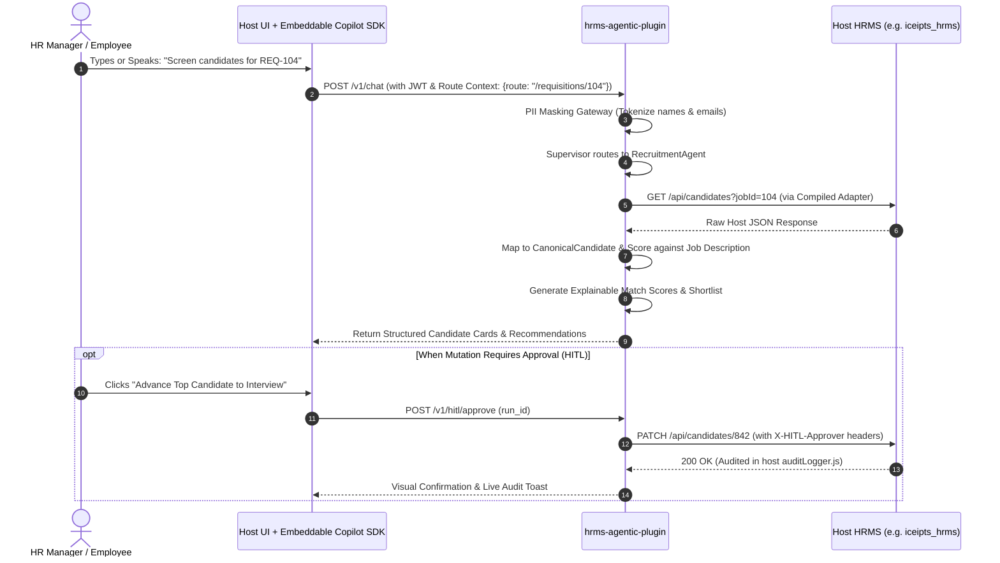

# Enterprise Agentic HRMS AI Plugin: Phase-Wise Implementation Plan

## Document Metadata
* **Document**: `PHASE_WISE_PLAN.md`
* **Repository**: `hrms-agentic-plugin` (Standalone Product & Sidecar Microservice)
* **Design Philosophy**: 100% Host-Agnostic, Zero-Touch Integration, Autonomous Dynamic Schema Adaptation
* **Target Host Platforms**: `iceipts_hrms`, Frappe/ERPNext, BambooHR, Darwinbox, Workday, Custom REST
* **Version**: 1.0.0-PROD
* **Status**: Approved for Engineering Execution

---

## Table of Contents
1. [Product Overview & Architectural Boundary](#1-product-overview--architectural-boundary)
2. [Communication & Protocol Specification](#2-communication--protocol-specification)
3. [The 5-Stage Dynamic Schema Engine](#3-the-5-stage-dynamic-schema-engine)
4. [Phase-by-Phase Engineering Roadmap](#4-phase-by-phase-engineering-roadmap)
   - [Phase 1: Standalone Scaffolding & Dynamic Schema Core](#phase-1-standalone-scaffolding--dynamic-schema-core)
   - [Phase 2: Universal REST Connector & Runtime Engine](#phase-2-universal-rest-connector--runtime-engine)
   - [Phase 3: Multi-Agent Fleet & Statutory Legal RAG](#phase-3-multi-agent-fleet--statutory-legal-rag)
   - [Phase 4: Zero-Trust Governance & Host Audit Attribution](#phase-4-zero-trust-governance--host-audit-attribution)
   - [Phase 5: Embeddable Frontend Copilot SDK & HITL UI](#phase-5-embeddable-frontend-copilot-sdk--hitl-ui)
   - [Phase 6: The 5-Tier Testing Pyramid & Production Hardening](#phase-6-the-5-tier-testing-pyramid--production-hardening)
5. [The 5-Tier Production Quality Pyramid](#5-the-5-tier-production-quality-pyramid)
6. [Distribution & Deployment Topologies](#6-distribution--deployment-topologies)
7. [Production Readiness & Acceptance Checklist](#7-production-readiness--acceptance-checklist)
8. [Audit Findings (2026-10-27)](#8-audit-findings-2026-10-27)
9. [Architecture Decisions: Open Questions Answered](#9-architecture-decisions-open-questions-answered)
10. [Revised Roadmap: Phases 7–11](#10-revised-roadmap-phases-711)

---

## 1. Product Overview & Architectural Boundary

The **`hrms-agentic-plugin`** is an independent, host-agnostic intelligence microservice designed to make **any existing HRMS agentic** without requiring code changes to the host application.

```
┌──────────────────────────────────────────────────────────────────────────────────┐
│                   CUSTOMER'S HRMS (System of Record - Untouched)                  │
│       [iceipts_hrms | Frappe | BambooHR | Workday | Custom In-House REST]        │
│          • Relational DB  • Standard REST Endpoints  • Core HR Business Logic    │
└────────────────────────────────────────┬─────────────────────────────────────────┘
                                         │ HTTPS / Webhooks / OAuth2
┌────────────────────────────────────────▼─────────────────────────────────────────┐
│              STANDALONE REPOSITORY: `hrms-agentic-plugin` (Sidecar)               │
│                                                                                  │
│   ┌──────────────────────────────────────────────────────────────────────────┐   │
│   │ 1. Dynamic Schema Engine                                                 │   │
│   │    • OpenAPI 3.x / Swagger 2.0 & JSON Sample Harvester                   │   │
│   │    • Semantic Synthesizer (Host Schema ➔ Canonical Domain Models)        │   │
│   │    • Shadow Verification Prober & Quality Grader                         │   │
│   │    • Sub-millisecond Compiled Runtime FieldMap Cache                     │   │
│   └──────────────────────────────────────────────────────────────────────────┘   │
│                                        │                                         │
│   ┌────────────────────────────────────▼─────────────────────────────────────┐   │
│   │ 2. Cognitive Agent Fleet & Supervisory Brain                             │   │
│   │    • Supervisor Agent & 14 Domain Specialists (Recruitment, Leave, etc.) │   │
│   │    • Multi-Jurisdiction Statutory Legal RAG (IN, AE, SA, US)             │   │
│   │    • Autonomous Diff & Patch Generator                                  │   │
│   └──────────────────────────────────────────────────────────────────────────┘   │
│                                        │                                         │
│   ┌────────────────────────────────────▼─────────────────────────────────────┐   │
│   │ 3. Enterprise Governance & Security Boundary                             │   │
│   │    • Dynamic PII Masking & Vault Tokenization                            │   │
│   │    • Human-In-The-Loop (HITL) Gate (Quorum, Separation of Duties)        │   │
│   │    • Append-Only Audit Trail & Action Attribution Headers                │   │
│   └──────────────────────────────────────────────────────────────────────────┘   │
│                                        │                                         │
│   ┌────────────────────────────────────▼─────────────────────────────────────┐   │
│   │ 4. Serving Surfaces & Embeddable SDK                                     │   │
│   │    • REST / WebSocket API (`/v1/chat`, `/v1/schema`, `/v1/remediate`)   │   │
│   │    • Model Context Protocol (MCP) Server (for Claude, Cursor, Copilot)   │   │
│   │    • Embeddable Frontend Copilot SDK (Web Component / Script Tag)        │   │
│   └──────────────────────────────────────────────────────────────────────────┘   │
└──────────────────────────────────────────────────────────────────────────────────┘
```

### Key Operating Invariants:
1. **Zero Database Disruption**: The plugin connects via standard REST endpoints and webhooks; it never issues direct SQL queries to the customer's production database.
2. **Deterministic Writes**: Write mutations (e.g. updating employee profiles, adjusting leave balances, posting requisitions) never rely on unconstrained LLM runtime guessing; they execute via compiled, verified `FieldMap` adapters.
3. **Statutory Mathematical Precision**: Calculations for payroll, wage protection, tax withholdings, and overtime are performed via Python `Decimal` engines rather than generative text approximations.
4. **Non-Repudiation**: Every agent-initiated mutation carries explicit attribution headers detailing the agent run ID, the human approver ID, and the cryptographic hash of the reasoning trace.

---

## 2. Communication & Protocol Specification

Because this is a standalone product, all boundaries are mediated over standard network protocols:



---

## 3. The 5-Stage Dynamic Schema Engine

To adapt to any HRMS without code modification, the plugin runs a 5-stage discovery and runtime compilation lifecycle:

1. **Stage 1 (Perception)**: `SchemaIntrospector` scans OpenAPI/Swagger specs or harvests 5–10 sample JSON records from host endpoints. It infers field names, types (`string`, `number`, `boolean`, `date`, `datetime`, `array`, `object`), nullability, and enums.
2. **Stage 2 (Cognition)**: `MappingSynthesizer` aligns discovered host fields with Canonical Domain Models (`CanonicalEmployee`, `CanonicalLeaveRequest`, `CanonicalRequisition`, etc.) using semantic matching, token normalization, and synonym dictionaries.
3. **Stage 3 (Verification)**: `ShadowProber` executes dry-run transformations on harvested samples, checking for nullability violations, type coercion failures, and missing primary keys.
4. **Stage 4 (HITL Review)**: Generates a visual review card displaying confidence scores (e.g., `emp_doj` ➔ `joining_date` [98%]) and prompts the admin to confirm ambiguous mappings.
5. **Stage 5 (Deterministic Execution)**: Compiles the confirmed mapping into high-speed declarative `FieldMap` objects cached in memory for sub-millisecond runtime execution.

---

## 4. Phase-by-Phase Engineering Roadmap

```
┌─────────────────────────────────────────────────────────────────────────────────────────────────┐
│                     6-PHASE ROADMAP: STANDALONE `hrms-agentic-plugin`                           │
├──────────┬───────────────────────────────────────┬──────────────────────────────────────────────┤
│ Phase 1  │ Standalone Scaffolding & Dynamic Core │ Introspector, Canonical Models, Synthesizer   │
├──────────┼───────────────────────────────────────┼──────────────────────────────────────────────┤
│ Phase 2  │ Universal REST Connector & Runtime    │ Dynamic REST Client, Concurrency & Idempotency│
├──────────┼───────────────────────────────────────┼──────────────────────────────────────────────┤
│ Phase 3  │ Multi-Agent Fleet & Statutory RAG     │ Supervisor, 14 Domain Agents, Labor Gazettes  │
├──────────┼───────────────────────────────────────┼──────────────────────────────────────────────┤
│ Phase 4  │ Zero-Trust Governance & Security      │ PII Masking, Vault Tokens, Audit Integration  │
├──────────┼───────────────────────────────────────┼──────────────────────────────────────────────┤
│ Phase 5  │ Embeddable Frontend Copilot SDK       │ Web Component, Shadow DOM, PostMessage sync   │
├──────────┼───────────────────────────────────────┼──────────────────────────────────────────────┤
│ Phase 6  │ The 5-Tier Testing Pyramid & CI/CD    │ Unit, Contract, Invariant, Drift, Playwright  │
└──────────┴───────────────────────────────────────┴──────────────────────────────────────────────┘
```

---

### Phase 1: Standalone Scaffolding & Dynamic Schema Core

#### Objectives
Initialize the standalone repository, establish build tooling (UV/Poetry, pre-commit, Ruff), and implement the autonomous schema adaptation engine.

#### Deliverables & Module Breakdown
1. **Repository Scaffolding**:
   - `pyproject.toml`: Modern Python 3.11+ configuration with UV/Poetry.
   - `.github/workflows/ci.yml`: Automated linting, type-checking (Pyright/Mypy), and test runners.
   - `deploy/Dockerfile`: Multi-stage distroless production container.
2. **`hrms_plugin/schema/introspector.py`**:
   - OpenAPI 3.x and Swagger 2.0 parser (YAML & JSON).
   - Black-box JSON sample harvester with type inference (`FieldDataType`).
   - Primary key and enum candidate heuristic detectors.
3. **`hrms_plugin/schema/canonical.py`**:
   - Universal domain entities: `CanonicalEmployee`, `CanonicalLeaveRequest`, `CanonicalRequisition`, `CanonicalCandidate`, `CanonicalPunch`, `CanonicalAsset`.
4. **`hrms_plugin/schema/synthesizer.py`**:
   - Semantic alignment engine with compound name handling (`first_name` + `last_name` ➔ `full_name`).
   - Automatic enum translation matching (e.g. host `APPROVED` ➔ canonical `OPEN`).
5. **`hrms_plugin/schema/prober.py`**:
   - Pre-flight verification prober generating structured `ProbeReport` with quality scoring (0.0 to 1.0).

#### Phase 1 Verification Gate
* **Test Suite**: `tests/unit/test_schema_introspector.py`, `tests/unit/test_synthesizer.py`, `tests/unit/test_prober.py`.
* **Benchmark**: Test against real-world `iceipts_hrms` OpenAPI spec (`swagger.yaml`) and synthetic custom schemas.
* **Pass Criteria**: 100% test pass rate; >= 95% mapping accuracy on core fields.

---

### Phase 2: Universal REST Connector & Runtime Engine

#### Objectives
Build the high-speed execution layer that takes compiled `FieldMap` rules and executes live read/write queries against host HRMS instances with concurrency control and idempotency.

#### Deliverables & Module Breakdown
1. **`hrms_plugin/connectors/base.py` & `dynamic_rest.py`**:
   - Asynchronous HTTP/2 client (`httpx`) with connection pooling and keep-alive.
   - Fast declarative mapping compiler executing paths, joins, and transforms in `< 1ms`.
2. **Pre-Built Vendor Profiles (`hrms_plugin/connectors/profiles/`)**:
   - `iceipts.py`: Out-of-the-box support for `iceipts_hrms` models (Employee, Requisition, Leave, Attendance).
   - `frappe.py`: Frappe/ERPNext DocType adapter.
   - `bamboohr.py` & `workday.py`: Verified enterprise SaaS profiles.
3. **Concurrency & Idempotency Manager (`hrms_plugin/connectors/concurrency.py`)**:
   - Optimistic concurrency control using host version tokens (`SourceRef.version`, `ETag`).
   - Deterministic SHA-256 idempotency deduplication keys preventing double-booking or duplicate payroll lines.
4. **Saga Rollback Coordinator (`hrms_plugin/connectors/compensation.py`)**:
   - Compensating transaction engine that unwinds partial mutations if a multi-step workflow fails.

#### Phase 2 Verification Gate
* **Test Suite**: `tests/contract/test_dynamic_rest_connector.py`, `tests/unit/test_concurrency.py`.
* **Benchmark**: 500 concurrent write operations with simulated network drops and 409 Conflict responses.
* **Pass Criteria**: Zero duplicate records created; 100% of conflicting writes safely caught.

---

### Phase 3: Multi-Agent Fleet & Statutory Legal RAG

#### Objectives
Port the proven 14 specialized domain agents and the multi-jurisdiction labor law knowledge base into the standalone microservice.

#### Deliverables & Module Breakdown
1. **`hrms_plugin/agents/supervisor.py`**:
   - LangGraph-based intent classification and conversational routing.
   - Multi-turn state machine surviving pod restarts via PostgreSQL checkpointing.
2. **14 Specialized Domain Agents (`hrms_plugin/agents/`)**:
   - `recruitment.py`: Automated requisition drafting, semantic bias removal, explainable ATS scoring.
   - `leave_attendance.py`: Policy validation, balance check, impossible-travel anomaly detection.
   - `statutory_payroll.py`: Decimal-exact gross-to-net calculations, tax structuring, and compliance checks.
   - `compliance.py`: Sourced legal audits flagging wage protection, overtime, and contract breaches.
   - `voice.py`: Speech-to-text (`saaras`) and text-to-speech (`bulbul`) via Sarvam AI.
3. **Statutory Legal Corpus (`hrms_plugin/rag/`)**:
   - India Code on Wages 2019, EPF & MP Act 1952, ESI Act 1948.
   - UAE Federal Decree-Law No. 33 of 2021 (14-day FNF, ILOE, Emiratisation).
   - Saudi Labor Law & US Fair Labor Standards Act (FLSA).
   - Mandatory statutory citation engine: uncited compliance flags are structurally refused.

#### Phase 3 Verification Gate
* **Test Suite**: `tests/statutory/test_statutory_payroll_invariants.py`, `tests/unit/test_supervisor.py`.
* **Pass Criteria**: 100% calculation accuracy against statutory penny/paisa benchmarks; 100% citation compliance.

---

### Phase 4: Zero-Trust Governance & Host Audit Attribution

#### Objectives
Establish enterprise security controls, PII redaction gateways, and non-repudiation audit pipelines compatible with host audit loggers (such as `iceipts_hrms/middleware/auditLogger.js`).

#### Deliverables & Module Breakdown
1. **PII Masking Gateway (`hrms_plugin/security/masking.py`)**:
   - Scans and tokenizes personal emails, phone numbers, national IDs (Aadhaar, SSN, Emirates ID), and exact salaries before sending prompts to external LLMs.
   - Re-hydrates synthetic tokens only on egress to verified host endpoints.
2. **Host Audit Integration & Tracing Headers**:
   - Every mutating request to the host injects enterprise attribution headers:
     ```http
     X-Agent-Invocation-Id: run_98f12a-3b
     X-Agent-Name: StatutoryPayrollAuditor
     X-HITL-Approver-Id: usr_mgr_4821
     X-Reasoning-Hash: sha256:8f4c...
     ```
   - Sanitizes payloads before transit to prevent secret leakage in host audit logs.
3. **Multi-Tenant Row-Level Security (RLS)**:
   - Tenant isolation enforced at database connection level (`SET LOCAL app.current_tenant_id`). Zero data contamination between client tenants.

#### Phase 4 Verification Gate
* **Test Suite**: `tests/security/test_pii_masking.py`, `tests/security/test_tenant_isolation.py`.
* **Red-Team Test**: 1,000 adversarial prompts attempting prompt injection to exfiltrate salaries or national IDs.
* **Pass Criteria**: Zero PII exfiltration; 100% of mutating actions successfully attributed in host audit logs.

---

### Phase 5: Embeddable Frontend Copilot SDK & HITL UI

#### Objectives
Create a drop-in, zero-conflict frontend widget that embeds the AI copilot into any host HRMS layout with real-time route context synchronization.

#### Deliverables & Module Breakdown
1. **`sdk/src/web-component.ts`**:
   - Standalone `<hrms-copilot>` Web Component distributed via single script:
     ```html
     <script src="https://cdn.your-hrms-plugin.com/copilot.min.js" data-tenant="client_01" defer></script>
     ```
   - Encapsulated inside **Shadow DOM** to prevent CSS bleeding into host layouts.
   - Bundle size < 120KB gzipped; cold-start render time < 150ms.
2. **`sdk/src/DiffModal.tsx` & `CopilotDrawer.tsx`**:
   - Slide-out conversational drawer with audio waveform display for voice input.
   - Side-by-side Visual Diff Viewer highlighting current state vs. agent proposed patch.
   - 1-Click "Approve & Execute" button triggering verified writebacks.
3. **Context Synchronization (`sdk/src/postmessage.ts`)**:
   - Listens to host route navigation (e.g. `/employees/128` or `/requisitions/REQ-901`) and synchronizes entity context automatically.

#### Phase 5 Verification Gate
* **Test Suite**: `sdk/tests/unit/widget.test.ts`, `tests/e2e/test_copilot_drawer.py`.
* **Pass Criteria**: Zero style collisions on Bootstrap, Tailwind, and legacy CSS host portals; bundle < 120KB.

---

### Phase 6: The 5-Tier Testing Pyramid & Production Hardening

#### Objectives
Execute end-to-end multi-tier verification across all integration boundaries, ensuring production resilience before enterprise deployment.

#### Deliverables & Module Breakdown
1. **CI/CD Build & Packaging Pipeline**:
   - Automated GitHub Actions running linting, formatting, security scanning (Trivy, Bandit), and test suites on every commit.
   - Multi-arch Docker images (`amd64`, `arm64`) published to container registries.
2. **Schema Drift Monitoring & Self-Healing Interceptor**:
   - Runtime interceptor that catches HTTP 400 Bad Request or unexpected host schema changes, raises `SchemaDriftWarning`, and alerts the mapping agent to generate a delta patch.
3. **Observability & OpenTelemetry Tracing**:
   - OTLP trace and metric export (`/v1/traces`, `/v1/metrics`) to Datadog, Grafana, or Prometheus.

---

## 5. The 5-Tier Production Quality Pyramid

```
                       ▲
                      / \
                     /   \     Tier 5: Playwright E2E Browser Tests
                    / E2E \    (Widget interaction, HITL 1-click approvals)
                   /───────\
                  /         \   Tier 4: Schema Drift & Adversarial Invariance
                 /   DRIFT   \  (Re-running on mutated schemas, broken network)
                /─────────────\
               /               \ Tier 3: Statutory & Decimal Math Invariants
              /    STATUTORY    \ (PF, ESI, WPS, Gratuity, Overtime to the penny)
             /───────────────────\
            /                     \ Tier 2: Contract & Concurrency Integration
           /       CONTRACT        \ (WireMock host APIs, ETag conflict, idempotency)
          /─────────────────────────\
         /                           \ Tier 1: Core Unit Tests
        /            UNIT             \ (Type transforms, path resolve, PII masking)
       /───────────────────────────────\
```

| Tier | Focus Area | Framework | Target Command |
| :--- | :--- | :--- | :--- |
| **Tier 1 (Unit)** | Transforms, path traversal, PII masking | Pytest | `pytest tests/unit/` |
| **Tier 2 (Contract)** | Simulated host REST APIs, retry ladders, 409 conflicts | WireMock / Respx | `pytest tests/contract/` |
| **Tier 3 (Statutory)** | PF, ESI, TDS, WPS decimal calculations | Pytest / Decimal | `pytest tests/statutory/` |
| **Tier 4 (Drift)** | Mutated schemas, null injections, missing fields | Hypothesis / Fuzzing | `pytest tests/drift/` |
| **Tier 5 (E2E)** | Headless browser widget interaction & HITL approvals | Playwright | `npx playwright test` |

---

## 6. Distribution & Deployment Topologies

To support different client IT policies, `hrms-agentic-plugin` can be deployed in three topologies:

```
┌──────────────────────────────────────────────────────────────────────────────────┐
│                   THREE ENTERPRISE DISTRIBUTION TOPOLOGIES                       │
├──────────────────────────┬───────────────────────────────────────────────────────┤
│ 1. Multi-Tenant Cloud    │ Fully managed SaaS sidecar cluster. Clients configure │
│    SaaS                  │ API tokens and embed the script tag. Zero infra cost. │
├──────────────────────────┼───────────────────────────────────────────────────────┤
│ 2. On-Premises Private   │ Single Docker container or Kubernetes Helm chart      │
│    VPC Container         │ deployed directly inside the customer's cloud VPC.    │
├──────────────────────────┼───────────────────────────────────────────────────────┤
│ 3. Standalone MCP Server │ Model Context Protocol server exposing HR tools to    │
│                          │ enterprise AI assistants (Claude, Cursor, Copilot).   │
└──────────────────────────┴───────────────────────────────────────────────────────┘
```

---

## 7. Production Readiness & Acceptance Checklist

Before declaring production readiness for client onboarding, the following criteria must be satisfied:

- [ ] **Schema Adaptation Gate**: Introspector correctly parses Swagger/OpenAPI and raw JSON samples with >= 95% accuracy.
- [ ] **Deterministic Write Gate**: Zero hallucinated keys emitted to host write endpoints; all mutations pre-validated via Pydantic.
- [ ] **Statutory Math Gate**: 100% calculation match on statutory payroll tests down to 0.0001 precision.
- [ ] **PII Protection Gate**: Zero raw national IDs, personal contact details, or salaries exposed in unmasked LLM prompts.
- [ ] **Host Audit Integration Gate**: All mutating requests contain valid attribution headers captured by host audit logs (`auditLogger.js`).
- [ ] **Widget Performance Gate**: Embeddable copilot bundle size < 120KB gzipped; Shadow DOM renders without CSS bleeding.
- [ ] **Concurrency Gate**: 500 simultaneous write requests handled with zero duplicate records and 100% conflict detection.

---

## 8. Audit Findings (2026-10-27)

An adversarial code audit found that the components in Phases 1–6 exist but are not connected into a working path from the HRMS, through the agents, and back to the HRMS. Headline findings:

| Area | Finding | Evidence |
|---|---|---|
| Build | 2 tests fail, `ruff` reports 11 errors, so CI is red | `pytest`, `ruff check .` |
| Deploy | Container cannot start (no `hrms_plugin/server/__main__.py`); the healthcheck calls `/health` but the route is `/healthz` | `deploy/Dockerfile`, `docker-compose.yml` |
| Auth | No authentication. The tenant comes from a client header, and the approver role comes from the request body | `server/app.py:334` |
| PII | The vault stores values in plaintext SQLite, and any caller who knows the tenant ID can unmask tokens | `storage/vault_store.py`, `security/masking.py:161` |
| SDK | XSS through `innerHTML`, and the `postMessage` listener has no origin check | `sdk/copilot.js:29,194,297` |
| Schema engine | The connector layer, probing and drift detection are not used by the server; the LLM mapping step always fails silently | `schema/synthesizer.py:832` |
| Actions | `/v1/remediate/execute` returns `APPROVED_AND_QUEUED` but never writes anything | `server/app.py:356` |
| LLM | Without an API key the service silently uses a fake LLM. Anthropic tool calls fail, and streaming double-calls the LLM | `ai/llm.py`, `agents/orchestrator.py:230` |
| Claims | "14 agents" (there are 8 plus a router), "Decimal-exact" (results are `float`), US payroll (missing), Sarvam voice (stub) | `agents/` |

Phase 7 below fixes these before any feature work.

---

## 9. Architecture Decisions: Open Questions Answered

**Governing principle: the LLM runs at configuration time, never at transaction time.**
The LLM may *propose* a mapping during onboarding or after drift is detected. A human approves it, and it is compiled into a versioned, declarative `FieldMap`. Every live request then runs on that compiled mapping with zero LLM involvement. Calculations never take numbers from the LLM.

### Q1. One vendor calls it "CTC", another "salary". How does the PF tool know which field to use?

The tool never decides, and neither does the LLM at call time.

1. **Canonical model with precise meanings.** "Salary" is not a single field. The canonical model defines distinct fields, each carrying its unit, period and currency:
   - `annual_ctc`
   - `gross_monthly`
   - `basic_monthly`
   - `dearness_allowance_monthly`
   - `pf_wage_monthly`

   The PF tool's input contract is `pf_wage_monthly` (basic + DA, subject to the statutory wage ceiling and the wage definition in the Code on Social Security). It never accepts CTC or "salary".
2. **Mapping registry keyed by `(tenant, vendor, entity, mapping_version)`.** Resolution order:
   1. Tenant override (customer X's `salary` means gross monthly).
   2. Vendor profile default (Zoho's `Basic` maps to `basic_monthly`).
   3. LLM suggestion, which stays *pending* until a human approves it.
3. **Derived fields are code, not mapping.** If the host only exposes CTC, `pf_wage_monthly` comes from a per-tenant **salary-structure rule** (for example basic = 40% of CTC), entered by the customer's payroll admin during onboarding. If no rule exists, the tool refuses to calculate and returns `MISSING_INPUT`; it never guesses.
4. **Tools take record IDs, not amounts.** The LLM calls `calculate_pf(employee_id=…, period=…)`. The tool fetches the record through the connector and applies the approved mapping. The LLM cannot pass in a wrong number.

### Q2. The host payload changes and the plugin uses the wrong field, so the calculation is wrong

Fail closed. Never calculate on an unverified shape.

1. **Schema fingerprint per mapping version.** Hash the field names and types of every incoming payload. If it doesn't match the approved fingerprint, quarantine the record, alert, and skip the calculation. Today `schema/drift.py` detects drift but is not wired in.
2. **Strict validation of canonical data.** Pydantic models with units and range checks, for example:
   - `basic_monthly` ≤ `gross_monthly` ≤ `annual_ctc / 12`
   - currency matches the jurisdiction
   - no negative amounts

   Any violation raises an error instead of being coerced.
3. **Cross-checks on every calculation.** Salary components must add up to CTC, and the deduction ceiling must hold. A difference from last month's run above a set threshold goes to human review.
4. **Record where each value came from.** Every result stores the mapping version, the source field paths and the input values. A wrong figure can then be traced to its cause and recalculated in bulk.
5. **Shadow mode for new mapping versions.** Run the old and new versions side by side for one payroll cycle, then promote the new one only if the outputs match or the differences are explained.
6. **Contract tests per vendor.** Recorded payload fixtures run in CI, so a vendor-side change breaks the build instead of producing wrong pay.

### Q3. If the LLM works out the schema, how do we keep PII under control?

1. **Schema only, never values.** The LLM receives field *names*, types and enums from the OpenAPI spec, or a structure inferred from samples. It never sees record values. If samples are needed, generate synthetic values from the types.
2. **Classify PII locally and deterministically, before the LLM step.**
   - A field-name dictionary.
   - Value detectors run inside the plugin: Aadhaar (Verhoeff checksum), PAN, IBAN (mod-97), Emirates ID, SSN, email, phone.
   - An open-source engine such as Microsoft Presidio can be used for free text.
3. **Treat unknown fields as PII.** Any field not yet classified counts as PII until a human classifies it. Classification is part of the same approval screen as the mapping.
4. **Minimise data at runtime.** Each tool declares the canonical fields it needs. The connector fetches only those fields, and only the fields marked "LLM-visible" reach a prompt. The regex token masking stays as a second layer only; it does not catch names, salaries or free text.
5. **Log every prompt.** Hash and store every outbound LLM payload per tenant, and run an automated check that blocks a prompt containing any value classified as PII.

### Q4. LLM-driven adaptation is expensive in API bills. How do we control it?

The LLM must not rewrite code at runtime. Run it once, compile the result, and reuse it.

| Step | LLM use | Cost |
|---|---|---|
| Synonym and rule matching | None | 0 |
| LLM fallback for the remaining *unmatched* fields only, on a small model | Once per tenant × vendor × entity | ~3–5k tokens per entity, cents |
| Shared vendor library: the same Zoho schema across customers reuses the approved mapping | None after the first customer | 0 |
| Drift: send only the *changed* fields | Only when the fingerprint changes | Small |
| Live requests | None; compiled `FieldMap` | 0 |

Also cut the chat agent's own spend (separate from adaptation):
- Pick 1–3 tools from the intent instead of sending all 14 schemas (~1.8k tokens per call).
- Skip the LLM for calculations whose arguments are already known.
- Send the model a compact view of tool results.
- Enable prompt caching.
- Fix the streaming double call.
- Track spend with per-tenant token budgets.

### Q5. Does anything like this already exist?

Yes, and that changes the build-vs-buy decision.

| Category | Examples | Notes |
|---|---|---|
| Unified HRIS APIs (commercial) | Merge, Finch, Kombo, Knit, Apideck, Unified.to | Each normalises many HRIS vendors into one data model. Some store copies of customer data, others pass requests straight through to the vendor. That difference matters for data residency |
| Integration infrastructure (open source) | Nango (unified HRIS models incl. BambooHR), Airbyte / Singer taps (read-only sync), n8n, Activepieces | Nango is the closest open reference for "declarative per-vendor sync and actions" |
| Vendor MCP servers | Zoho runs a managed MCP platform (`mcp.zoho.com`). No official Zoho People connector was confirmed; Zoho People MCP servers exist from third parties (Pipedream, community) | Treat third-party MCP servers as untrusted code |
| Standards | SCIM 2.0 (provisioning users and groups), HR Open Standards | Covers identity data only, not payroll |
| Enterprise iPaaS | Workato, MuleSoft, Boomi | Mapping built by hand, with mature governance |

**Decision to make:** build our own connectors (a moat, but slow), or use a unified API for the connector layer and differentiate on the canonical HR model, statutory engines, compliance agents and approval workflows. The recommendation is a hybrid: unified API for long-tail vendors, our own profiles for priority vendors (iCeipts, Zoho, Frappe) where write depth matters.

The comparisons found online are mostly written by these vendors. Evaluate each against a real Zoho/BambooHR tenant before deciding.

### Q6. Zoho uses REST. If we use MCP, who translates the payload? Doesn't this end up as custom code per vendor?

Yes, and that is unavoidable. MCP is the interface between the LLM and the tools; it does not replace the vendor adapter.

```
LLM ──MCP──► plugin tool: get_employee(id) ──► Connector (Zoho profile) ──REST──► Zoho People API
                                  ▲                       │
                                  └── canonical model ◄── FieldMap (approved, versioned)
```

The goal is **"configuration, not code"** per vendor, not "no per-vendor work":
- A **generic engine** (`DynamicRESTConnector`) handles HTTP, retries, idempotency, pagination and rate limits.
- A **declarative profile** per vendor (YAML) covers auth type, base URL, endpoints, pagination style, ID encoding and write verbs.
- The **FieldMap** (YAML, versioned) covers field translation.
- **Small code hooks** are allowed only for real oddities, such as Zoho's form-encoded `inputData` or Workday's SOAP.

Most HR vendors fall into a handful of patterns (REST+JSON, OData, SOAP, form-encoded), so after the first 5–6 profiles each new vendor is mostly configuration. A vendor's own MCP server, if one exists, can replace our connector for reads. Writes still go through our policy and approval layer.

### Q7. Sending HR data to an LLM for schema inspection is a data breach

It is a breach if raw records go to a third-party model without a legal basis. Controls:

1. **Architecture:** schema-only inspection (Q3). Runtime prompts contain only data-minimised fields the LLM is allowed to see.
2. **Choice of model per data-sensitivity tier:**
   - **Tier 1:** schema metadata only. Any approved provider.
   - **Tier 2:** pseudonymised operational data. A provider with zero data retention and a regional endpoint.
   - **Tier 3:** raw PII. A self-hosted open-weights model inside the customer's VPC, or no LLM at all.
3. **Contracts and legal:**
   - A data processing agreement (DPA) with each LLM provider, listed as a sub-processor.
   - Data residency per tenant.
   - A data protection impact assessment (DPIA) per customer.
   - Purpose limitation written into the customer's DPA.
4. **Regulations to map controls against:**
   - India: DPDP Act 2023.
   - UAE: PDPL, Federal Decree-Law No. 45 of 2021.
   - Saudi Arabia: PDPL.
   - GDPR for EU employees, and CCPA/CPRA for California.
5. **Deployment:** offer the on-prem / VPC topology (Section 6) as the default for enterprise payroll customers.
6. **Evidence:** a payload audit log per tenant, retention limits and deletion on request, and external review against a recognised standard (SOC 2 / ISO 27001) before any production payroll customer.

---

## 10. Revised Roadmap: Phases 7–11

Each phase ends with an acceptance command or a demonstrable gate. No phase starts until the previous gate passes.

### Phase 7: Stabilise (fix the audit findings)
- Fix startup (`server/__main__.py`) and the healthcheck path; get CI green (2 tests, 11 lint errors).
- **Authentication:** verify the JWT and take tenant and role from token claims only. Reject client-supplied `approver_role`.
- **SDK:** escape all rendered content, check `postMessage` origins, and add a strict Content Security Policy.
- **Vault:** encrypt with per-tenant keys (KMS), scope every lookup to the tenant, and use a shared store across replicas.
- **LLM layer:**
  - Fix the Anthropic `tool_use` format and the streaming double call.
  - Fix the `FieldMap` bug in `synthesize_agentic`.
  - Update the default models.
  - Use a shared HTTP client, with retry and backoff on 429/529.
- Label demo endpoints (`/compliance/dashboard/live`, sample-based `diagnose`, archetypes) or remove them. Correct the README claims.
- **Gate:** CI green; an external smoke test shows the remediation endpoint returns 403 without a valid token.

### Phase 8: One vendor end to end
- Wire `DynamicRESTConnector`, the vendor profile and the approved `FieldMap` into the compliance agent for **one** vendor (iCeipts or Frappe).
- Add the schema-fingerprint check, quarantine and strict canonical validation (Q2).
- Make write-back real: show the change, then an approved, idempotent write with a "before" snapshot for rollback.
- **Gate:** a real tenant's employees are audited, and one approved patch is written and then rolled back, with an audit record on both sides.

### Phase 9: Mapping governance and data protection
- Mapping registry with versions, tenant overrides and an approval screen; field classification on the same screen (Q1, Q3).
- Salary-structure rules per tenant; tools return `MISSING_INPUT` instead of guessing.
- Local PII classifier and the automated prompt check (Q3, Q7); per-tenant routing of model by data tier.
- Shadow mode for new mapping versions.
- **Gate:** the prompt-check test fails the build if any classified PII value reaches an LLM payload. Two tenants on the same vendor with different "salary" meanings produce correct PF figures.

### Phase 10: Cost and quality controls for the AI layer
- Tool subsets per intent, a zero-LLM path for calculations, compact tool results, prompt caching, and a forced final answer at the step limit (Q4).
- Per-tenant token accounting, budgets and rate limits.
- Citations taken only from tool or RAG output, using structured outputs.
- An evaluation set (graded HR and statutory questions plus recorded provider responses) tracking accuracy, tokens per answer and citation correctness.
- **Gate:** tokens per resolved request ≤ 1k at the median, with no accuracy regression on the evaluation set.

### Phase 11: Second vendor and the build-vs-buy decision
- Add a structurally different vendor (Zoho People or BambooHR) using a profile and FieldMap only, with no core engine changes.
- Run a time-boxed evaluation of one unified API (pass-through model preferred for data residency) and one open-source option (Nango) against the same tenant (Q5).
- **Gate:** the second vendor is onboarded with configuration plus ≤ 1 code hook, and a written build-vs-buy decision is recorded as an ADR.

### Additional readiness gates (extends Section 7)
- [ ] **Fail-Closed Gate**: A payload whose schema fingerprint is unknown never reaches a calculation tool.
- [ ] **No-LLM-Numbers Gate**: No calculation tool accepts a monetary amount argument from the LLM; inputs come from the connector and the mapping only.
- [ ] **Prompt Data Gate**: Zero classified PII values in LLM payloads, enforced by an automated check in CI and at runtime.
- [ ] **Provenance Gate**: Every calculated figure records the mapping version and its source fields.
- [ ] **Cost Gate**: Per-tenant token budgets enforced; median tokens per request ≤ 1k.
- [ ] **Legal Gate**: DPA, sub-processor list and DPIA completed per production customer.
